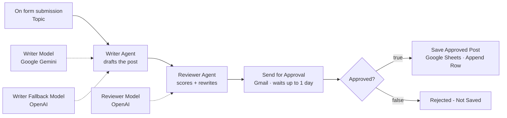

# LinkedIn Post Approval (n8n)

**Social Eagle Gen AI Architect Program · Week 4, Day 2**

An n8n workflow where AI drafts a LinkedIn post, a second AI reviews and improves it, and a human makes the final call. You type a topic into a web form. A **Writer Agent** (Google Gemini) drafts the post and a separate **Reviewer Agent** (OpenAI) rewrites it against a fixed set of standards. The result is emailed to you with **Approve** and **Reject** buttons, and the run pauses until you click one. Only approved posts are saved to Google Sheets.



---

## How it works

| # | Node | Type | What it does |
|---|------|------|--------------|
| 1 | On form submission | Form Trigger | Web form with one required field, `Topic` |
| 2 | Writer Agent | AI Agent | Drafts a 120–150 word post with a hook, one CTA and up to 3 hashtags |
| | ↳ Writer Model | Google Gemini Chat Model (`gemini-3.7-flash`, temperature 0.8) | Main model for the writer |
| | ↳ Writer Fallback Model | OpenAI Chat Model (`gpt-5-mini`) | Used automatically if Gemini fails or is overloaded |
| 3 | Reviewer Agent | AI Agent | Scores the draft on hook, clarity and CTA, rewrites the weakest part, and returns only the final post |
| | ↳ Reviewer Model | OpenAI Chat Model (`gpt-5-mini`) | A different provider from the writer |
| 4 | Send for Approval | Gmail – *Send message and wait for response* | Emails the post to me with Approve / Reject buttons. The run pauses here for up to 1 day |
| 5 | Approved? | IF | Checks `{{ $json.data?.approved === true }}` |
| 6 | Save Approved Post | Google Sheets – *Append Row* | True branch: writes `Date \| Topic \| Final Post \| Status` |
| 7 | Rejected - Not Saved | No Operation | False branch: ends the run without writing anything |

---

## Design decisions

### What standards does the reviewer judge against?
A reviewer can only improve what it is allowed to judge, so its system message gives it an explicit rubric instead of "make this better":

- **Scored out of 10:** Hook (does line one alone make someone read on?), Clarity (one idea, short sentences, no filler), and CTA (exactly one clear ask near the end).
- **Hard rules it must enforce:** 120–150 words; hook on line one; one CTA; at most 3 hashtags on the last line; plain text with no markdown (LinkedIn doesn't render it); at most 2 emojis; no invented statistics, quotes, names or stories; stays on topic.

The writer gets the same format rules, so the reviewer focuses on quality rather than fixing basic structure.

### Feedback, or the rewritten post?
**The rewritten post.** The next step is a human reading the email, and what I need to judge there is a post ready to publish, not a list of notes I'd then have to apply myself. The reviewer scores the draft privately to decide what to fix, but returns only the final post. It's the same text that lands in the email and in the sheet, so what I approve is exactly what gets saved.

### Why two different AI providers?
The writer runs on **Google Gemini** at temperature 0.8, so its drafts have some creative range. The reviewer runs on **OpenAI**. A model from a different provider doesn't share the writer's habits and phrasing, so it is more likely to spot a weak hook or a vague CTA than the same model reviewing its own work.

### What does Reject mean?
**Drop the post.** The sheet is meant to be a clean list of posts I've approved and can publish. Rejected posts would dilute it, and a rejected draft is easy to regenerate from the form. The false branch ends at a *No Operation* node, so the decision stays visible on the canvas and in the execution log, but nothing is written.

*(Alternative I considered: append rejected posts to a separate `Rejected` tab with `Status = Rejected`, for a record of what didn't make it. That would need only a second Sheets node on the false branch.)*

### What if I never click?
The Gmail node's wait is capped at **1 day**. When it times out, n8n resumes with the incoming data instead of an approval, so there's no `data.approved` field. The IF expression uses optional chaining (`$json.data?.approved === true`), so a timeout returns `false` and is treated like a rejection: no error, nothing saved.

### What happens when the AI service is busy?
During testing, Gemini returned `503 – This model is currently experiencing high demand` several times, which stopped the run. Two layers now handle this:

1. **Fallback model:** the Writer Agent has *Enable Fallback Model* turned on, with an OpenAI model connected. If Gemini fails, the agent switches to OpenAI for that request automatically.
2. **Retry On Fail:** both agents retry up to 5 times, 5 seconds apart, for any other temporary error.

### Why the `$('…')` references after the email step?
After you click a button, the Gmail node outputs only `{ "data": { "approved": true/false } }`. The topic and the post are no longer in `$json`, so the email, IF and Sheets nodes read them by node name:
`$('On form submission').first().json.Topic` and `$('Reviewer Agent').first().json.output`.

---

## Prompts

**Writer Agent** (Source for Prompt: *Define below*)
```
Write a LinkedIn post about: {{ $json.Topic }}

Rules:
- Line one is the hook: one short sentence that makes a professional stop scrolling.
- 120-150 words in total.
- Short paragraphs of 1-2 sentences, with a blank line between them.
- Exactly one call to action, near the end.
- At most 3 hashtags, on the last line.

Return the post only - no title, no preamble, no quotation marks.
```

**Reviewer Agent** (Source for Prompt: *Define below*)
```
Topic: {{ $('On form submission').first().json.Topic }}

Draft post:
"""
{{ $json.output }}
"""

Review this draft against your standards and return the improved final post.
```
The full system messages, including the reviewer's rubric, are under **Options → System Message** on each agent and in the exported JSON.

---

## Key node settings

**Writer Agent and Reviewer Agent → Settings**

| Setting | Value |
|---|---|
| Retry On Fail | On |
| Max Tries | 5 |
| Wait Between Tries (ms) | 5000 |

**Writer Agent → Parameters:** *Enable Fallback Model* = On

**OpenAI Chat Model nodes** (Writer Fallback Model, Reviewer Model)

| Setting | Value |
|---|---|
| Model | `gpt-5-mini` |
| Use Responses API | **Off** (the Agent node v2.2 doesn't accept Responses API models) |
| Options → Reasoning Effort | Low |
| Sampling Temperature | Not set (GPT-5 models only accept the default) |

**Send for Approval (Gmail)**

| Setting | Value |
|---|---|
| Resource / Operation | Message / Send message and wait for response |
| To | my own Gmail address |
| Subject | `LinkedIn post for approval: {{ topic }}` |
| Response Type | Approval |
| Approval Options → Type | Approve and Disapprove (labels: *Approve* / *Reject*) |
| Options → Limit Wait Time | After time interval, 1 day |
| Options → Append n8n Attribution | Off |

**Save Approved Post (Google Sheets)**

| Column | Value |
|---|---|
| Date | `{{ $now.setZone('Asia/Kolkata').toFormat('yyyy-MM-dd') }}` |
| Topic | `{{ $('On form submission').first().json.Topic }}` |
| Final Post | `{{ $('Reviewer Agent').first().json.output }}` |
| Status | `Approved` |

---

## Issues I hit and how I fixed them

| Error | Cause | Fix |
|---|---|---|
| `404 – models/gemini-2.5-flash is no longer available to new users` | Google retired Gemini 2.5 Flash for new API keys | Switched the Writer Model to a current Gemini Flash model |
| `Workflow execution cannot start – Parameter "Document" is required` | The Sheets node had no document or sheet selected after import | Selected the *LinkedIn Posts* document and *Sheet1* in **Save Approved Post** |
| `503 Service unavailable – model is experiencing high demand` | Gemini was overloaded | Moved the Reviewer to OpenAI, added an OpenAI fallback model to the Writer, and turned on **Retry On Fail** on both agents |
| `This fallback model is not supported in 2.2 version of the Agent node` | New OpenAI Chat Model nodes have *Use Responses API* on by default, which Agent v2.2 rejects | Turned **Use Responses API** off on both OpenAI nodes |
| `Referenced node doesn't exist – The node 'On form submission' doesn't exist` | The form trigger's name didn't exactly match the name used in the expressions | Retyped the trigger's name as `On form submission` and re-mapped the Topic field by dragging it from the input panel |

---

## Sample output

```
Date       | Topic       | Final Post                 | Status
2026-10-22 | <my topic>  | <final post from the run>  | Approved
```

---

## Setup

### Prerequisites
- An n8n instance (I use self-hosted n8n)
- A Google account, with a Google Cloud project and OAuth client
- A Google Gemini API key from [Google AI Studio](https://aistudio.google.com/apikey), for the writer
- An OpenAI API key from [platform.openai.com](https://platform.openai.com/api-keys) with credit on the account, for the reviewer and the writer's fallback

### 1. Google Sheet
Create a sheet named **LinkedIn Posts** with these headers in row 1:

| Date | Topic | Final Post | Status |
|------|-------|------------|--------|

### 2. Google Cloud
Enable the **Gmail API**, **Google Sheets API** and **Google Drive API** (Drive lets n8n list your sheets in the dropdown) on your project.

### 3. n8n credentials
- **Gmail OAuth2 API** and **Google Sheets OAuth2 API:** the same Client ID and Client Secret, then *Sign in with Google*.
- **Google Gemini (PaLM) API:** paste the AI Studio key.
- **OpenAI API:** paste the OpenAI key.

### 4. Import and run
1. **Workflows → Import from File** → select `LinkedIn_Post_Approval.json`.
2. Select your Gemini credential on **Writer Model**, and your OpenAI credential on **Writer Fallback Model** and **Reviewer Model**.
3. On **Send for Approval**, select your Gmail credential and set **To** to your own address.
4. On **Save Approved Post**, select your Sheets credential, then the **LinkedIn Posts** document and sheet. Check that the four columns are still mapped.
5. Save, then click **Execute workflow** and submit a topic in the form that opens.

### Testing both paths
- **Approve:** submit a topic → open the email → click **Approve** → a new row appears with `Status = Approved`.
- **Reject:** submit another topic → click **Reject** → the run ends at *Rejected - Not Saved* and the sheet is unchanged.

---

## Repository contents

```
├── LinkedIn_Post_Approval.json   # exported n8n workflow
├── screenshots/
│   ├── workflow-canvas.png       # the workflow on the n8n canvas
│   ├── approval-email.png        # the email with Approve / Reject buttons
│   └── sheet-row.png             # the approved row in Google Sheets
└── README.md
```

## Screenshots


## Demo video

`<link to the screen recording in the community>`

---

## Security note

API keys and Google OAuth secrets live only in the **n8n credential store**. The exported JSON contains credential names, never the secrets, and no pinned test data.

---

**Author:** Remya · Social Eagle Gen AI Architect Program
